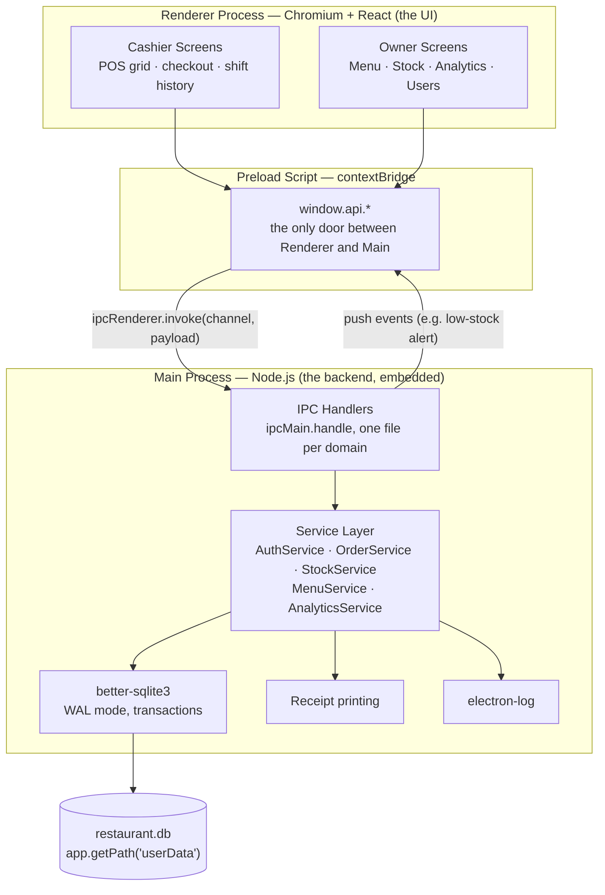
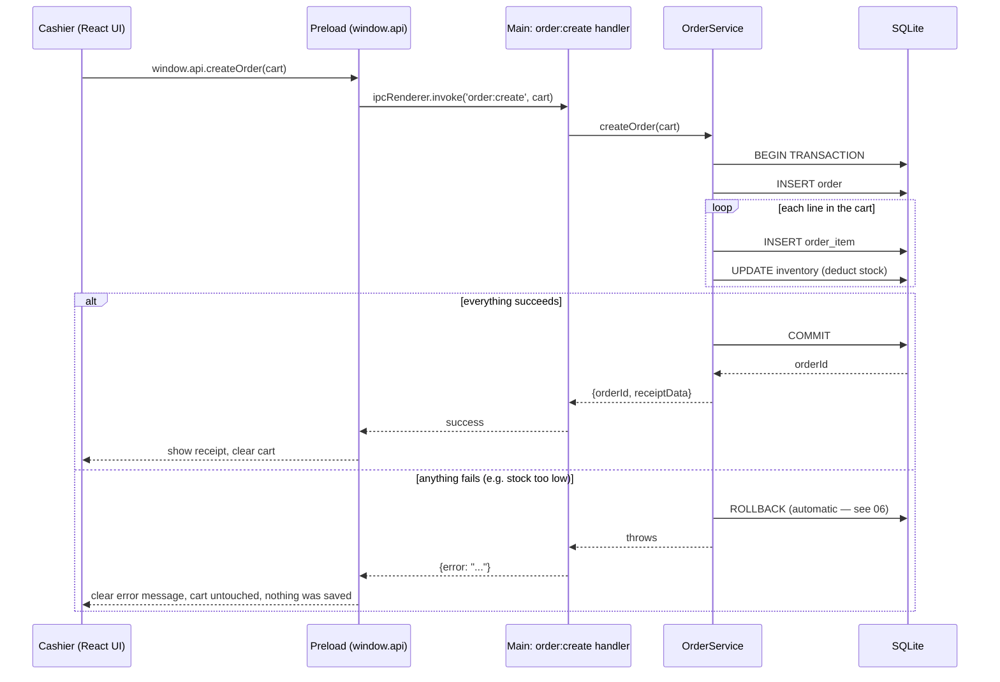

# 01 — System Architecture

## The core idea

Everything runs **locally, on the till PC, with no dependency on the internet.** A restaurant POS that stops working because the WiFi hiccuped is a POS that has failed at its one job. The database is a single SQLite file on disk. There is no cloud server in the critical path — not for login, not for checkout, not for stock. If you want cloud backup or a remote dashboard later, that's an add-on layered on top, never a requirement for the till to function.

## Electron's process model (read this even if you know React/Node — Electron's split is not optional)

An Electron app is really **two separate JavaScript runtimes glued together**, and understanding this is the difference between a secure, stable app and a fragile one:

- **Main process** — plain Node.js. One instance, started when the app launches. Has full OS access: filesystem, native modules, printers. This is where your database lives and your business logic runs.
- **Renderer process** — a Chromium browser window running your React app. This is the UI. It should **not** have direct access to Node.js, the filesystem, or the database — not because React can't handle it, but because anything rendered in a browser context is a bigger attack surface, and a POS app touches money.
- **Preload script** — the *only* bridge between the two, using `contextBridge`. It exposes a small, explicit set of functions to the renderer (`window.api.createOrder(...)`, etc.) — nothing more.



**Why not just run an Express server and `fetch()` it from React**, like a typical web app? You can, and I've noted where that pattern actually earns its keep (see "If you add a second terminal" below). But for a single-machine app, a local HTTP server buys you almost nothing and costs you something real: Windows Firewall will often throw a security prompt the first time a local server binds a port, which is a confusing moment for a restaurant owner who just wants to open the till. IPC has no such prompt — it's process-to-process communication inside the same app, not a network socket. Fewer moving parts, one less way for the app to look "broken" on someone's first launch.

## The IPC contract — how the parts actually talk

This is the API surface of your app. Treat it as seriously as you would a REST API, because it is one — it just doesn't happen to go over HTTP.

| Channel | Direction | Purpose | Payload → Response |
|---|---|---|---|
| `auth:login` | Renderer → Main | Authenticate | `{username, password}` → `{userId, role, fullName}` |
| `auth:loginByPin` | Renderer → Main | Fast cashier login | `{pin}` → `{userId, role, fullName}` |
| `menu:list` | Renderer → Main | Get categories + items | `{}` → `MenuItem[]` |
| `menu:upsert` | Renderer → Main | Create/edit item — **owner only** | `MenuItem` → `MenuItem` |
| `menu:setActive` | Renderer → Main | 86 an item / bring it back | `{itemId, isActive}` → `{success}` |
| `order:create` | Renderer → Main | Submit a completed order | `{cashierId, items[], paymentType}` → `{orderId, receiptData}` |
| `order:void` | Renderer → Main | Void an order — **PIN-gated** | `{orderId, voidedBy, reason}` → `{success}` |
| `order:list` | Renderer → Main | Order history, filtered | `{filters}` → `Order[]` |
| `stock:list` | Renderer → Main | Current stock levels | `{}` → `StockItem[]` |
| `stock:restock` | Renderer → Main | Add stock — **owner only** | `{inventoryId, qty, reason}` → `{success}` |
| `analytics:summary` | Renderer → Main | Dashboard cards + trend | `{range}` → `{today, week, month, trend[]}` |
| `analytics:topItems` | Renderer → Main | Best/worst sellers, latest items | `{range, limit}` → `{best[], worst[], newest[]}` |
| `printer:printReceipt` | Renderer → Main | Send receipt to printer | `{orderId}` → `{success}` |
| `app:lowStockAlert` | **Main → Renderer** (push) | Notify UI of a threshold breach | pushes `{inventoryId, itemName, currentQty}` |

Every handler on the Main side re-checks the caller's role before doing anything — the renderer telling you it's the owner means nothing on its own; the Main process looks up the *actual* logged-in session. UI-level hiding of the "Delete Item" button is a UX nicety, not a security boundary. The real boundary is in the IPC handler.

## Data flow: creating an order (the critical path)

This is the sequence that has to be bulletproof, since it touches money and stock at the same time.



The important property: **the order and every stock deduction it causes live inside one atomic transaction.** There is no state where an order exists but stock wasn't deducted, or stock was deducted but the order wasn't saved. `06-reliability-engineering.md` shows the actual code for this.

## Folder structure

```
/src
  /main                      Node.js — the "backend"
    main.ts                  app lifecycle, window creation, security config
    preload.ts                contextBridge — the exposed API surface
    /ipc                      ipcMain.handle registrations, one file per domain
      auth.ipc.ts
      menu.ipc.ts
      order.ipc.ts
      stock.ipc.ts
      analytics.ipc.ts
    /services                 business logic — DB-aware, no Electron/UI concerns
      authService.ts
      menuService.ts
      orderService.ts
      stockService.ts
      analyticsService.ts
    /db
      db.ts                   better-sqlite3 connection + PRAGMA setup
      schema.sql               DDL (see 03-database-schema.md)
      migrations/
    /printing
      receiptPrinter.ts
  /renderer                   React app — the "frontend"
    /screens
      /cashier
        POSScreen.tsx
        OrderHistoryScreen.tsx
      /owner
        DashboardScreen.tsx
        MenuManagementScreen.tsx
        InventoryScreen.tsx
        AnalyticsScreen.tsx
        UsersScreen.tsx
    /components
    /state                    Zustand stores / React Query hooks
    /api                      thin wrapper around window.api.*
    App.tsx
    main.tsx
  /shared
    types.ts                  TypeScript types used by BOTH main and renderer
```

The `/shared` folder matters more than it looks: because Main and Renderer are two different processes, it's easy for their idea of what an `Order` object looks like to drift apart. One shared `types.ts`, imported by both sides, makes that impossible — the compiler catches it if they disagree.

## If you add a second terminal later

Everything above assumes one PC. If you eventually get a second register (or want the owner checking the dashboard from a back-office PC on the same network), the service layer doesn't change — you swap the *transport*. Instead of the Renderer talking to Main via IPC, each PC runs a thin Electron app whose Renderer calls a small Express server (running inside the Main process of *one* designated "host" PC, or a separate always-on mini-PC) over the LAN. The `OrderService`, `StockService`, etc. stay exactly as they are — you're only adding an HTTP layer in front of them. Design the service layer as plain functions that don't know or care whether they were called from `ipcMain.handle` or an Express route, and this upgrade is a few days of work, not a rewrite.
