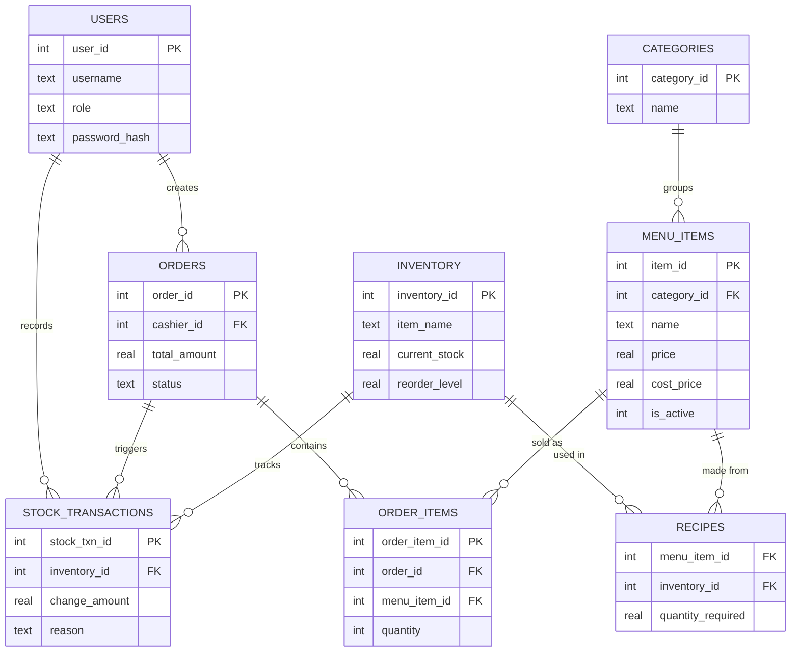

# 03 — Database Schema

## A note on your original schema

Your draft had this line:

```sql
category_id INTEGER FOREIGN KEY REFERENCES categories(category_id)
```

That's not valid SQLite. `FOREIGN KEY` as a keyword phrase is only legal as a **table-level** constraint (`FOREIGN KEY (col) REFERENCES ...` after the column list) — as an inline **column** constraint, you just write `REFERENCES categories(category_id)`, without the words "FOREIGN KEY" in front of it. Run the original as-is and SQLite throws a syntax error before the table is even created. Fixed below, along with some additions: `CHECK` constraints (so the database itself refuses a negative price or a zero quantity, instead of trusting the application code to always remember to check), indexes on the columns your analytics queries will actually filter and join on, and a `stock_transactions` audit table so "why is the stock count wrong" is answerable instead of a mystery.

## Entity relationship diagram



## Full schema

```sql
PRAGMA foreign_keys = ON;

CREATE TABLE users (
    user_id       INTEGER PRIMARY KEY AUTOINCREMENT,
    username      TEXT NOT NULL UNIQUE,
    pin_hash      TEXT,                            -- fast cashier PIN login, nullable
    password_hash TEXT NOT NULL,                    -- bcryptjs hash
    role          TEXT NOT NULL CHECK (role IN ('cashier','owner')),
    full_name     TEXT NOT NULL,
    is_active     INTEGER NOT NULL DEFAULT 1,
    created_at    TEXT NOT NULL DEFAULT (datetime('now'))
);

CREATE TABLE categories (
    category_id   INTEGER PRIMARY KEY AUTOINCREMENT,
    name          TEXT NOT NULL,
    display_order INTEGER NOT NULL DEFAULT 0
);

CREATE TABLE menu_items (
    item_id       INTEGER PRIMARY KEY AUTOINCREMENT,
    category_id   INTEGER NOT NULL REFERENCES categories(category_id),
    name          TEXT NOT NULL,
    price         REAL NOT NULL CHECK (price >= 0),
    cost_price    REAL NOT NULL DEFAULT 0 CHECK (cost_price >= 0),
    description   TEXT,
    image_path    TEXT,
    is_active     INTEGER NOT NULL DEFAULT 1,        -- soft delete / "86'd" toggle
    created_at    TEXT NOT NULL DEFAULT (datetime('now')),
    updated_at    TEXT NOT NULL DEFAULT (datetime('now'))
);

-- Raw ingredients. Skip this table entirely if you start with simple stock (see below).
CREATE TABLE inventory (
    inventory_id  INTEGER PRIMARY KEY AUTOINCREMENT,
    item_name     TEXT NOT NULL,
    unit          TEXT NOT NULL,                     -- 'kg', 'g', 'l', 'pieces'
    current_stock REAL NOT NULL DEFAULT 0,
    reorder_level REAL NOT NULL DEFAULT 0,
    cost_per_unit REAL NOT NULL DEFAULT 0
);

-- Recipe mapping: how much of each ingredient one sale of a menu item consumes.
CREATE TABLE recipes (
    menu_item_id      INTEGER NOT NULL REFERENCES menu_items(item_id),
    inventory_id      INTEGER NOT NULL REFERENCES inventory(inventory_id),
    quantity_required REAL NOT NULL CHECK (quantity_required > 0),
    PRIMARY KEY (menu_item_id, inventory_id)
);

CREATE TABLE orders (
    order_id      INTEGER PRIMARY KEY AUTOINCREMENT,
    cashier_id    INTEGER NOT NULL REFERENCES users(user_id),
    subtotal      REAL NOT NULL,
    tax           REAL NOT NULL DEFAULT 0,
    discount      REAL NOT NULL DEFAULT 0,
    total_amount  REAL NOT NULL,
    payment_type  TEXT NOT NULL CHECK (payment_type IN ('cash','card')),
    status        TEXT NOT NULL DEFAULT 'completed' CHECK (status IN ('completed','voided')),
    voided_by     INTEGER REFERENCES users(user_id),
    void_reason   TEXT,
    created_at    TEXT NOT NULL DEFAULT (datetime('now'))
);

CREATE TABLE order_items (
    order_item_id INTEGER PRIMARY KEY AUTOINCREMENT,
    order_id      INTEGER NOT NULL REFERENCES orders(order_id),
    menu_item_id  INTEGER NOT NULL REFERENCES menu_items(item_id),
    quantity      INTEGER NOT NULL CHECK (quantity > 0),
    unit_price    REAL NOT NULL,                       -- price AT TIME OF SALE — never re-read from menu_items later
    unit_cost     REAL NOT NULL DEFAULT 0
);

-- The audit trail. Every stock change, sale or otherwise, lands here with who/why/when.
CREATE TABLE stock_transactions (
    stock_txn_id      INTEGER PRIMARY KEY AUTOINCREMENT,
    inventory_id      INTEGER NOT NULL REFERENCES inventory(inventory_id),
    change_amount     REAL NOT NULL,                    -- negative = deducted, positive = restocked
    reason            TEXT NOT NULL CHECK (reason IN ('sale','restock','waste','adjustment')),
    related_order_id  INTEGER REFERENCES orders(order_id),
    created_by        INTEGER NOT NULL REFERENCES users(user_id),
    created_at        TEXT NOT NULL DEFAULT (datetime('now'))
);

-- Indexes for the queries you'll run constantly (see 05-analytics-dashboard.md)
CREATE INDEX idx_orders_created_at        ON orders(created_at);
CREATE INDEX idx_orders_status            ON orders(status);
CREATE INDEX idx_order_items_order_id     ON order_items(order_id);
CREATE INDEX idx_order_items_menu_item_id ON order_items(menu_item_id);
CREATE INDEX idx_inventory_reorder        ON inventory(current_stock, reorder_level);
CREATE INDEX idx_stock_txn_inventory_id   ON stock_transactions(inventory_id);
```

Two deliberate details worth calling out:
- **`order_items.unit_price` and `unit_cost` are copied at the time of sale**, not looked up from `menu_items` when you run a report later. If you raise the price of a menu item next month, last month's revenue reports must still reflect what people actually paid — this is what makes that true.
- **All timestamps are `TEXT` in ISO-8601** (SQLite's `datetime('now')` default), which sorts and filters correctly as a string and is what every date function in the queries below expects.

## Simple stock vs. recipe-based stock — pick one to start

Your draft went straight to recipe-based tracking (`inventory` + `recipes`, deducting raw ingredients like "200g chicken, 1 bun" per sale). That's the *more accurate* model — it tells you you're low on oil before you're actually out. It's also real setup work: every menu item needs its recipe defined before stock tracking means anything.

**The honest alternative for getting to a working system faster:** drop `inventory` and `recipes` entirely, and add one column directly to `menu_items`:

```sql
ALTER TABLE menu_items ADD COLUMN stock_quantity INTEGER NOT NULL DEFAULT 0;
```

One sale of an item decrements its own `stock_quantity` by 1. No recipes to define, no ingredient-level math. You lose the ability to see "we're low on oil" before a specific dish runs out — you only find out when *that dish's* count hits zero. For a fried chicken menu where items are mostly sold as discrete units (a piece, a combo, a sandwich), that's often a completely reasonable trade for shipping this month instead of next.

You can migrate from simple to recipe-based later without touching anything else in the schema — it's an additive change (add the two tables, backfill recipes, switch the deduction logic in `OrderService`), not a rewrite of orders, users, or menu_items.

## Migrations

Don't hand-run `ALTER TABLE` statements against production as you change your mind about the schema. Keep every schema change as a numbered `.sql` file in `/src/main/db/migrations/` (`001_init.sql`, `002_add_stock_transactions.sql`, ...), and on app startup, run whichever migrations haven't been applied yet, tracked in a tiny `schema_migrations(version INTEGER PRIMARY KEY, applied_at TEXT)` table. This is a handful of lines of code and it's the difference between "the schema evolves safely as you learn what the restaurant actually needs" and "I have three slightly different `.db` files on three different machines and no idea which is right."
